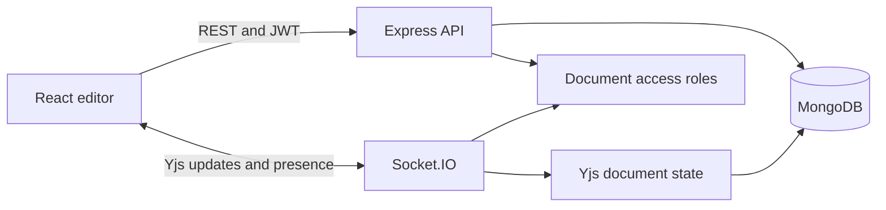

# Folio: Collaborative Document Editor

Folio is a MERN application for real-time Markdown writing. It uses Yjs (a CRDT) over Socket.IO so concurrent edits converge, MongoDB for durable documents and named versions, Express for the REST API, and JWT-protected accounts and document roles.

## Tech stack

- React 19 and Vite for the client
- Node.js and Express for the REST API
- MongoDB and Mongoose for users, documents, and versions
- Socket.IO for collaboration events and presence
- Yjs for conflict-free concurrent editing
- JWT and bcrypt for authentication

## Features

- Register and sign in with bcrypt-hashed passwords and signed JWTs.
- Create and rename documents, search the document list, and edit Markdown with a live preview.
- Share documents with registered users as editors or viewers. Ownership and role checks are enforced by the API and Socket.IO.
- See connected collaborators and synchronized save status.
- Save named snapshots, inspect version history, and restore a snapshot. Restore first preserves the current content as a new version.
- Yjs CRDT updates are broadcast to the document room and the latest state is stored in MongoDB.

## Architecture

## Portfolio summary

Folio demonstrates real-time collaboration, conflict resolution with a CRDT, persistence, authentication, and role-based access control in one full-stack application. See [the internship pitch and demo guide](docs/INTERNSHIP-PITCH.md) for a concise project explanation and resume bullet draft.

## Requirements

- Node.js 20.19+ or 22.12+
- MongoDB 6+ running locally or a MongoDB connection string

## Start locally

1. Install dependencies with `npm install`.
2. Copy `.env.example` to `.env` and replace `JWT_SECRET` with a long random value.
3. Make sure MongoDB is running and `MONGO_URI` points to it.
4. Run `npm run dev` and open `http://localhost:5173`.

The development command starts Vite on port 5173 and the API/Socket.IO server on port 4000. The API health endpoint is `http://localhost:4000/api/health`.

## Production build

Run `npm run build` to create the client bundle. Set the environment variables from `.env.example`, then use `npm start` to run the API and collaboration server. Serve the generated `dist` directory with a static web server and set `VITE_API_URL` and `VITE_SOCKET_URL` to the API origin before building.
